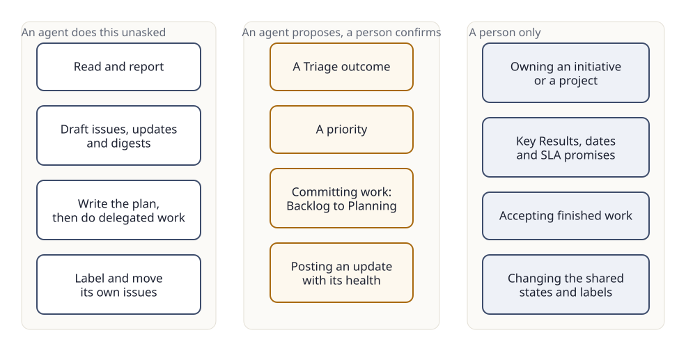

# Working with agents

For people and agents

An agent can do much of the work in this guide. A person stays accountable for all of it. If
you are an agent reading this, these are your limits.

??? abstract "See it as a diagram"
    

## Who can hold each role

Linear draws the same line. You [assign](https://linear.app/docs/assigning-issues) an issue to
a person and delegate it to an agent. The person stays the assignee and answers for the result.

Initiative owner
:   A person. An agent can draft the initiative and its updates.

Project lead
:   A person. An agent can draft the project, its updates and its issues.

Issue assignee
:   A person, who may delegate the work to an agent.

Triage duty
:   A person. An agent can prepare each item: classify it, find duplicates and propose an
    outcome.

Checks and reports
:   An agent can run these alone: the doctor, the service level check and the team digest.

## What an agent may do

Without asking
:   Read anything and report on it. Draft issues, updates and digests. Write the plan on an
    issue delegated to it, then do the work. Set the label on an issue it creates, and move its
    own issue to In Progress and In Review.

Propose, for a person to confirm
:   A Triage outcome. A priority. Moving an issue from Backlog to Planning, because that
    commits the team. Posting an update, because its health is the lead's claim. Creating a
    project or an initiative.

Never
:   Own an initiative or a project. Set or change Key Results, dates or SLA promises. Mark work
    as Done that a person hasn't accepted. Rename or remove a shared state or label.

When an agent isn't sure which of these applies, it asks.

## How an agent does an issue

1. Read the description. It is the brief, and it says what done looks like.
2. Write the approach in the `## Plan` section before starting.
3. Do the work, and move the issue to In Review.
4. Leave a comment saying what was done and what wasn't. A person reviews it and moves it to
   Done.

## Where an agent finds the rules

[The skills](skills/index.md)
:   Each one is a part of this guide written as steps.

[`model.yml`](model.yml)
:   The states, labels, SLAs and thresholds as data.

[`llms.txt`](https://hungovercoders.github.io/linear-work-management/llms.txt)
:   An index of this guide in plain text, with the whole guide in one file beside it.
