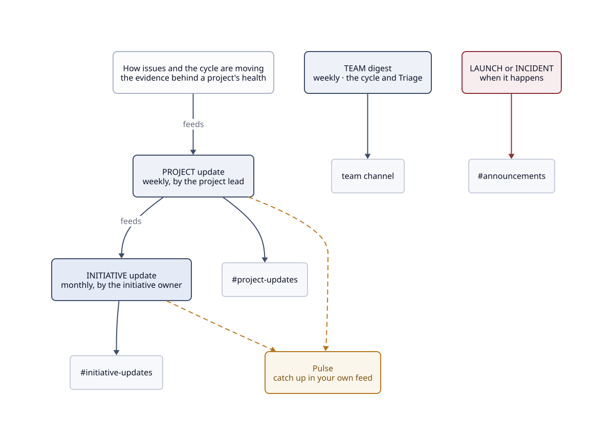

# Updates

Who posts which [update](https://linear.app/docs/initiative-and-project-updates), where and how
often. People should hear how things are going without having to ask, and without being buried in
messages.

??? abstract "See it as a diagram"
    

## Who posts what { #the-cadence }

  
Weekly<b>Project update</b>By the project lead, to <code>#project-updates</code>, while it's being built.

  
Monthly<b>Initiative update</b>By the initiative owner, to <code>#initiative-updates</code>, while it's active.

  
Weekly<b>Team digest</b>By the team, to its own channel: the cycle, and what came through Triage.

  
When it happens<b>Launches and incidents</b>By whoever ships or responds, to <code>#announcements</code>.

A skill can draft the update and the channel carries it. A named person is still responsible
for it going out.

## Saying how it's going { #health-is-a-claim-with-evidence }

Every update says on track, at risk or off track. That's a claim, so be ready to back it up.

A project's evidence is how its issues are moving and whether its Key Result is shifting. An
initiative's evidence is the updates from its projects.

!!! warning "Don't report green on top of silence"
    If a project hasn't reported, the initiative above it says so.

## So nobody has to remember { #making-the-cadence-stick }

- Linear reminds you. Switch on update reminders in workspace settings. Leads and owners get a
  prompt, then follow-ups, and an overdue project shows **Update Missing**.
- The skills do the gathering. `linear-project-update` reads what moved since last time, so you
  only check the draft and add your judgement.
- Silence shows up. The team digest and `task doctor` flag a project with no update for 10 days
  and an initiative with none for 35.

## Catching up with Pulse

[Pulse](https://linear.app/happydevs/pulse) is Linear's feed of every update
([how it works](https://linear.app/docs/pulse)). Its *For me* tab
shows the work you're involved in, and it can send you a daily or weekly digest.

Leads still post, because Pulse has nothing to show otherwise. Everyone else can read Pulse and
skip the channels.

??? note "How updates feed each other"
    <ol class="lwm-chain">
      <li data-then="is the evidence for"><b>Issues and the cycle</b>What moved this week</li>
      <li data-then="feeds"><b>Project update</b>Weekly, to <code>#project-updates</code></li>
      <li><b>Initiative update</b>Monthly, to <code>#initiative-updates</code></li>
    </ol>

    Both kinds of update also appear in Pulse, so a quiet project is visible there too.

??? note "Keeping channels quiet"
    One channel serves each audience, so all projects share `#project-updates`. Channel messages
    come from the updates themselves, and nobody posts a separate summary. `#announcements` is
    for launches and incidents only.
