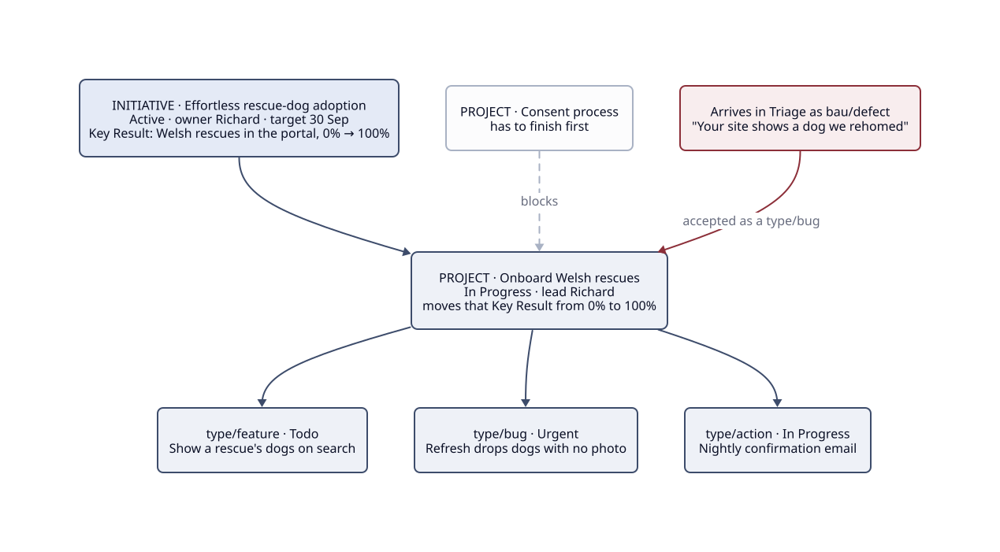

# Worked example

One real chain from top to bottom, using the dogadopt product. Open any step to see
what was written in Linear.

  
<b>Initiative</b>Effortless rescue-dog adoption<small>Owner Richard · Active · target 30 Sep 2026</small>

  
<b>Project</b>Onboard Welsh rescues<small>Lead Richard · In Progress · moves "Welsh rescues in the portal" from 0% to 100%</small>

  
<b>Issues</b>Show a rescue's dogs on search · Refresh job drops dogs with no photo · Nightly confirmation email<small>A feature, a bug and an action</small>

  
<b>From Triage</b>"Your site shows a dog we rehomed last week."<small>Arrived as bau/defect, accepted into the project as a bug</small>

??? abstract "See it as a diagram"
    

## 1. The initiative

The owner wanted one place to search every rescue. Three Key Results say how they'll know it
worked: every ADCH-registered Welsh rescue in the portal, 100 people a month searching, and
click-throughs to rescues.

It has Key Results, one owner and a target date, so rules 1, 4 and 5 are met. Two of the
evidence sources are still to be built, and they need sorting out before those results can be
scored.

??? note "The description in Linear"
    > ## Why this matters
    >
    > Finding a rescue dog in the UK means trawling dozens of rescue websites that don't talk to
    > each other. Adopters give up and dogs wait longer. One place to search every rescue changes
    > both.
    >
    > ## Key Results
    >
    > ### Measured
    >
    > | Key Result | Baseline | Target | Evidence |
    > |---|---|---|---|
    > | ADCH-registered Welsh rescues live in the portal | 0% | 100% | Coverage report (TBD, a dependency) |
    > | Monthly active users searching dogs | 0 | 100/month | Plausible dashboard |
    > | Outbound click-throughs to a rescue per month | 0 | 1 | Click tracking (TBD) |
    >
    > ## Out of scope
    >
    > Completed-adoption tracking (it happens on the rescue's side); rescues outside Wales this
    > quarter.
    >
    > ## Context
    >
    > Consent from each rescue is part of the bar. Scraping without it is a relationship and legal
    > risk, so onboarding includes a consent step.

## 2. The project

This began as an idea ("could we bring Welsh rescues together?") and joined the initiative when
it became `Planned`. It names the Key Result it moves and by how much, which is rule 2.

It runs 11 Aug to 12 Sep 2026 at High priority, labelled `spend/capex` and `product/dogadopt`.
It's blocked by the Consent process project, recorded as a
[dependency](projects.md#dependencies-native-never-prose) so it shows on the timeline.

??? note "The description in Linear"
    > ## What we're doing and how
    >
    > Onboard every ADCH-registered Welsh rescue: obtain consent, ingest their available dogs
    > via feed or manual entry, refresh at least weekly, and show them in the portal search.
    >
    > ## Key Results it moves
    >
    > | Initiative | Key Result | Delta (baseline → target) |
    > |---|---|---|
    > | Effortless rescue-dog adoption | Welsh rescues live in the portal | 0% → 100% |
    >
    > ## Out of scope
    >
    > Non-ADCH rescues; England/Scotland; adopter accounts.
    >
    > ## Context
    >
    > 12 rescues on the ADCH register at last count; the denominator may move, so recount at each
    > update.

## 3. Three of its issues

`type/feature` · Show a rescue's dogs on the search page
:   In `Todo`, refined and ready, with acceptance criteria.

`type/bug` · Refresh job drops dogs with no photo
:   `Urgent`, next to be picked up. It has steps to reproduce and says what's at stake:
    listings shrink without anyone noticing.

`type/action` · Nightly confirmation email to rescues
:   In progress. The assignee wrote the plan when they picked it up.

All three are in the project with one `type/*` label, so rule 3 is met.

??? note "The action's description, with its plan"
    > ## What needs doing?
    >
    > Nightly job emailing each consented rescue a link to confirm their listings are current.
    >
    > ## Why does it need doing?
    >
    > "Live" only counts if refreshed; stale listings break the coverage KR's definition.
    >
    > ## When is it done?
    >
    > Every consented rescue gets the nightly mail, and a bounce or 14-day silence flags the rescue
    > as stale in the coverage report.
    >
    > ## Context
    >
    > Rescues asked for email over a portal login, so meet them where they are.
    >
    > ## Plan
    >
    > Cloudflare Worker cron 02:00 → for each consented rescue, send confirm-link (Email
    > Service) → confirmation hits a Worker route stamping `last_confirmed` → coverage report
    > reads the stamp. No login needed; link is signed, 14-day expiry.

## 4. Something arrives through Triage

An email comes in: "Your site shows a dog we rehomed last week." Whoever is on
[triage duty](issues/triage.md) makes three calls.

What is it?
:   A `bau/defect`: a fault someone reported.

Where does it go?
:   Into the onboarding project. It's a bug in the refresh job that project is building, so it
    becomes a `type/bug` there and the `bau/*` label comes off.

How urgent?
:   High. It damages trust, but nothing is down. An outage would be a `bau/incident`, decided at
    once.

Had it been a one-off question, such as "how many collies are listed in Powys?", it would have
stayed BAU as a `bau/query`.

## What this shows

Every piece answers "why?" for the one below it. The nightly email keeps listings fresh. Fresh
listings are what the Key Result counts. The project promises to move that Key Result, and the
initiative says why anyone cares.
