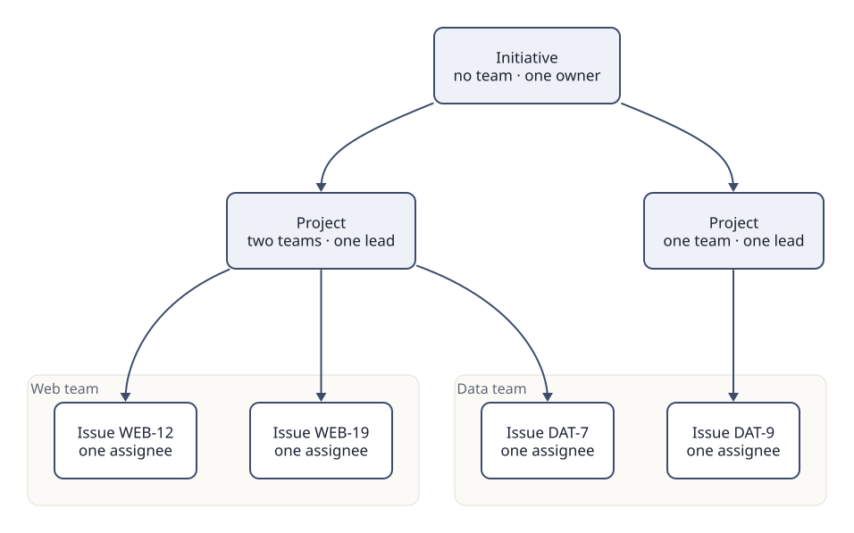

# Teams

For everyone

In Linear a [team](https://linear.app/docs/teams) can lead a project or an initiative, but other
teams can still work on it. Only an issue belongs to one team and no other.

??? abstract "See it as a diagram"
    

## From initiative down to issue

Linear gets stricter about teams the further down you go.

  
<b>Initiative</b>Can have a lead team. Its projects can come from anywhere in the company.<small>One owner · one lead team at most · any number of teams involved</small>

  
<b>Project</b>Has a lead team. Other teams can contribute, and it holds issues from each of them.<small>One lead · one lead team · any number of contributing teams</small>

  
<b>Issue</b>Belongs to exactly one team. It can't be shared.<small>One assignee · one team only</small>

Linear works this way because outcomes don't follow the org chart: "Effortless rescue-dog adoption"
needs web, data and partnerships work. So an initiative or a project names one team as its lead,
which says who drives it, and still takes work from others. The one-to-one rule arrives at the
issue, because that's where one person in one team does the work.

## What a team owns

Its issues
:   Every issue has exactly one team. You can see which in its ID: `WEB-12` belongs to Web.

Its Triage inbox
:   Requests to the team arrive in [its own Triage](issues/triage.md), from its own asks channel.

Its cycles
:   An issue is planned into its own team's cycle. You can't see two teams' cycles in one view.

Its states
:   Each team has the [shared states](teams.md#issue-states), and can add its own.

## What a team can lead, but shares

Projects
:   One team is the [lead team](https://linear.app/docs/projects). The others contribute, and
    Linear shows a tab for each team's issues. The lead team decides which project statuses are
    available. You can filter projects by lead team to see what each team is driving.

Initiatives
:   A team can lead an [initiative](https://linear.app/docs/initiatives) too, on the Business
    and Enterprise plans. It still appears in the one list for the whole workspace, and its
    projects can belong to other teams.

Labels
:   Our [label groups](teams.md#the-label-taxonomy) are set for the whole workspace, so
    `bau/support` means the same in every team.

## Who is accountable

A lead team tells you which team is driving. It doesn't tell you who to ask, and the work
still crosses teams. So [rule 4](hard-rules.md) asks for one named person as well.

An initiative
:   Its owner, with a lead team if you've set one.

A project
:   Its lead, usually from the lead team, however many teams contribute.

An issue
:   Its assignee, inside the team it belongs to.

## Working across teams

You need something from another team
:   Add that team to your project and create the issue in their team. It arrives in their
    Triage, they decide when to do it, and it still shows in your project.

One piece of work needs two teams
:   Make two issues, one in each team, in the same project. Link them as blocking or related
    if the order matters.

An issue is in the wrong team
:   Move it. It gets a new ID (the old one still works), its status changes to the nearest
    match in the new team, and it may drop out of its cycle.

You're not sure whose cycle it's in
:   The issue's team. Projects don't live in cycles. Their issues do, each in its own team's.

??? note "Sub-teams and private teams"
    Linear lets you nest teams. A [sub-team](https://linear.app/docs/sub-teams) can inherit its
    parent's states, cycles and labels, and the parent's views show every sub-team's work. A
    team can also be private, which hides its issues from everyone outside it. Neither changes
    the rule above: each issue still belongs to exactly one team.
