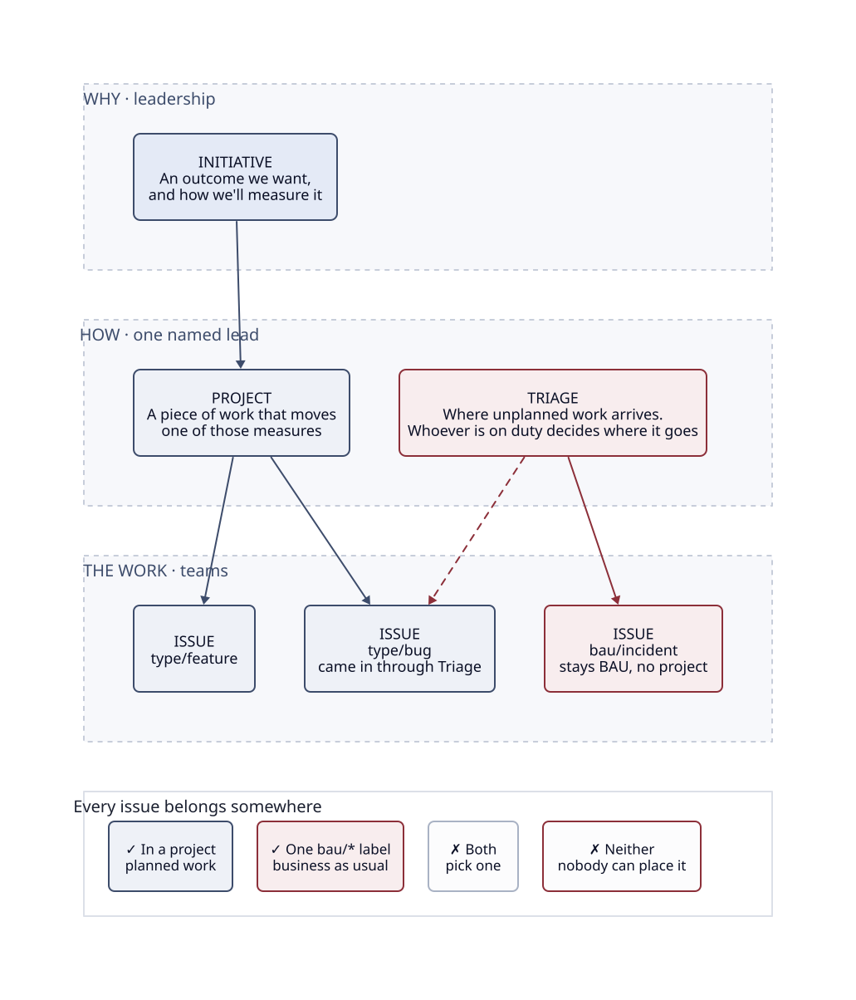

# Know *why* you're doing what you're doing

This is how we use Linear. Every task connects to a project, and every project to an outcome
someone cares about. Five minutes here is enough to get going.

[See a real example](examples.md){ .md-button .md-button--primary }
[The five rules](hard-rules.md){ .md-button }

??? abstract "See it as a diagram"
    

## Three levels, and one side door

Planned work sits on three levels. Each one answers "why?" for the level below it.

[Initiative](initiatives.md){ .lwm-name }An outcome we want, and how we'll measure it.<small>Effortless rescue-dog adoption</small>

[Project](projects.md){ .lwm-name }A piece of work that moves one of those measures.<small>Onboard the 12 Welsh rescues</small>

[Issue](issues/index.md){ .lwm-name }One task someone can pick up and finish.<small>Show a rescue's dogs on the search page</small>

[BAU](issues/triage.md){ .lwm-name }Things break and people ask for help. That's business as usual. It arrives through Triage and gets a <code>bau/*</code> label, with no project needed.<small>A rescue emails: "you're still showing a dog we rehomed"</small>

## The five rules

That's the whole rulebook. If a rule and a shortcut disagree, the rule wins.

  

<b>Every initiative says how it will be measured.</b>Write its Key Results before any project goes under it.

  

<b>Every project says which Key Result it moves, and by how much.</b>Needed once the project is planned. Ideas can wait.

  

<b>Every issue is in a project or has one <code>bau/*</code> label.</b>One or the other. An issue with neither gets lost.

  

<b>One named person owns each initiative and each project.</b>A person. Teams and pairs don't count.

  

<b>Initiatives and projects have dates once they're planned.</b>Without dates, nothing can be put in order.

[Why these five](hard-rules.md)

## Where do you fit?

[Leadership<b>Initiatives</b>You own an outcome and how it's measured.](initiatives.md){ .lwm-card .is-slate }

[Delivery leads<b>Projects</b>You own a piece of work: what, how and when.](projects.md){ .lwm-card .is-slate }

[Delivery teams<b>Project work</b>You pick up issues and finish them.](issues/project-work.md){ .lwm-card .is-slate }

[On triage duty<b>Triage and BAU</b>You decide what happens to whatever arrives.](issues/triage.md){ .lwm-card .is-red }

## Not sure what to create?

An outcome we want by a date
:   An [initiative](initiatives.md).

Work that moves one of its measures
:   A [project](projects.md) under that initiative.

One task within that work
:   An [issue](issues/project-work.md) in the project.

Something broke, or someone asked
:   An issue through [Triage](issues/triage.md). Colleagues can raise one from Slack by posting
    in your team's asks channel.

An idea you want to explore
:   A project in `Idea`. It needs a lead and a line on what you're exploring. This is the easiest
    way to start anything.

## Let the skills do the routine parts

You don't have to remember the templates. Ask Claude to "draft an initiative", "write up this
bug" or "work through Triage with me", and a [skill](skills/index.md) does it to this standard.
