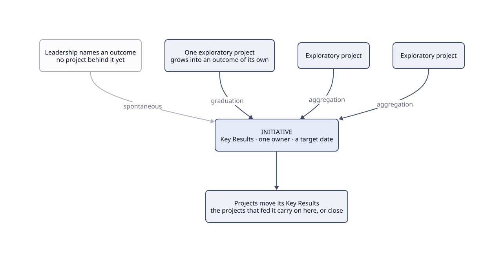

# Initiatives

For strategic leadership. An initiative is an outcome we want, plus the measures that tell us
whether we got it. It says why the work matters and leaves the building to the
[projects](projects.md) underneath.

[See every initiative in Linear.](https://linear.app/happydevs/initiatives) That list is our
strategy on one screen: each outcome, who owns it and how it's going.

!!! abstract "In short"
    - An initiative needs four things: an inspiring name, Key Results, one owner and a target
      date.
    - Write the Key Results first. Without them you have a theme, and nothing to score.
    - While it's `Active`, the owner posts an update every month.
    - The `linear-initiative` skill walks you through all of it.

---

## What goes in one

Start with the name. Make it an objective people can get behind, such as "Make onboarding
effortless".

Then add the Key Results, which say how you'll know it worked. Aim for three to five, and write
them into the initiative's description. There are two kinds, so use whichever fits and don't
force a number where one doesn't belong.

| Kind | Use it for | Scored by |
|---|---|---|
| Measured | Outcomes you can count | How far the number moved from its baseline to its target |
| Committed | Work that simply has to happen (compliance, contracts, hard deadlines) | Done or not done, against a definition of done |

They look like this in the description:

| Measured KR | Baseline | Target | Evidence |
|---|---|---|---|
| Activation rate | 22% | 30% | Signups reaching first value in 7 days |
| Weekly active teams | 140 | 200 | Teams with ≥1 active member per week |

| Committed KR | Definition of Done | Evidence |
|---|---|---|
| SOC 2 Type II | Report issued with no exceptions | Auditor's signed report |

These Key Results are what your delivery leads sign up to. Each project underneath picks one and
says how far it will move it ([rule 2](hard-rules.md)), and they're what you score at the end.

The description holds the why, the Key Results, what's out of scope and any context. How the
outcome gets built belongs in the projects.

!!! tip "New initiative, or part of an existing one?"
    Ask whether the work would move a Key Result that an existing initiative already has. If it
    would, link the project there. Start a new initiative only when the outcome is new. A few
    sharp initiatives beat many that overlap.

---

## Where initiatives come from

Few initiatives start fully formed. There are three ways one begins.

| Origin | What happened |
|---|---|
| Graduation | One exploratory project grew into an outcome big enough to stand alone. Most initiatives start this way |
| Aggregation | Several exploratory projects turned out to be parts of the same larger outcome |
| Spontaneous | Leadership names an outcome directly, with no project behind it yet |

Whichever it is, the initiative still has to declare its Key Results. When it grew out of
projects, build on what they found. The `linear-initiative` skill reads those projects, uses
their findings for the objective and the baselines, and links them so the history is kept.
Afterwards each project either carries on as delivery work under the initiative or closes.

---

## Owner and date

Every initiative has one owner ([rule 4](hard-rules.md)): someone senior enough to say why it
matters and how we'll know it worked. The owner answers for the outcome. They don't have to
build it.

It also has a target date, set when the initiative is agreed ([rule 5](hard-rules.md)). You need
the date that early because deciding what comes first happens before any work starts. Fit the
date to the outcome. Many initiatives suit a quarter, and a big programme might run a year or
more.

---

## The states it moves through

Linear fixes these five states, so there's nothing to configure.

| State | Means | Move on when |
|---|---|---|
| Proposed | Being considered, not yet agreed | Leadership agrees it's worth doing |
| Planned | Agreed and prioritised, with owner, Key Results and target date set | Work begins |
| Active | Work is underway and projects are moving its Key Results | The Key Results are met, or time runs out |
| Completed | Key Results met, or the period ended and was scored | |
| Canceled | Dropped, with the reason recorded | |

Two of those moves matter most. Going from `Proposed` to `Planned` is the agreement: leadership
says yes, and the owner, Key Results and date are all in place. Going from `Planned` to `Active`
is the kick-off. After that it's a matter of scoring the Key Results and closing it.

---

## Monthly updates { #keep-everyone-posted }

While an initiative is `Active`, its owner posts an update to `#initiative-updates` every month.
It covers how the Key Results have moved, the health (on track, at risk or off track) and any
risks.

You can write the update on the initiative in Linear and set its health there, and it posts to
the connected channel. Or let the `linear-initiative-update` skill draft and post it.

!!! warning "Only as current as its projects"
    The monthly update is built from the weekly project updates underneath. If a project hasn't
    reported, or its update is old, say so, and don't claim better health than the evidence
    supports. The skill points out missing and stale project updates for you.

[Communications](communications.md) has the full schedule, and explains
[what a health claim needs](communications.md#health-is-a-claim-with-evidence).

---

## Create one

1. The quick way is the `linear-initiative` skill, listed under [Skills](skills/index.md). It
   asks about the outcome, the Key Results, the owner and the date, then gives you the
   description to paste in.
2. To do it by hand, create an initiative in the
   [Linear initiatives view](https://linear.app/happydevs/initiatives) and paste in
   [`template.md`](https://github.com/hungovercoders/linear-work-management/blob/main/skills/linear-initiative/template.md).
   It's the same file the skill uses.

Either way, set the owner, the status (`Proposed` to begin with) and the target date in Linear's
own fields, and keep them out of the description. Then connect the `#initiative-updates` Slack
channel so updates post there.

??? note "Sub-initiatives, for large programmes (Enterprise plan only)"
    On Linear's Enterprise plan you can nest initiatives up to five levels deep. A parent rolls
    up the projects and progress of its children, so you get one view of the whole programme
    while each sub-initiative keeps its own owner and Key Results.

    They're worth using when a company objective spans several teams that each need an owner, or
    when a large goal splits into phases worth tracking separately. On any other plan, keep it
    flat: initiative, then project.

---

## Related

- [The hard rules](hard-rules.md): rules 1, 4 and 5 apply here
- [Projects](projects.md): the work that moves an initiative's Key Results
- [Start here](index.md): the overview
