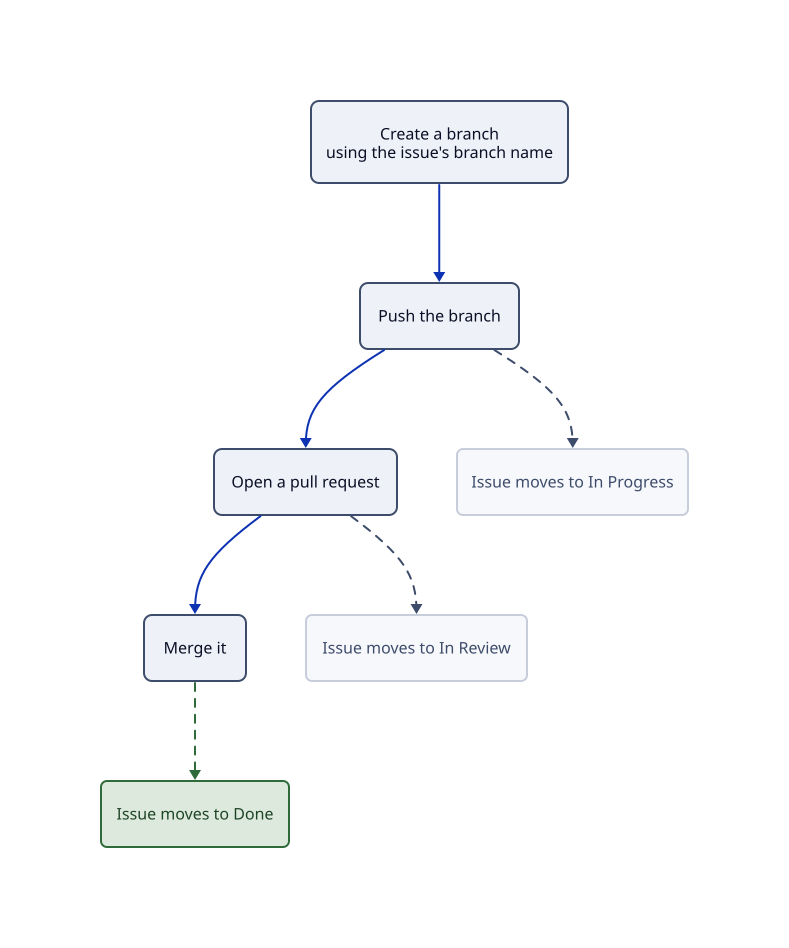

# :material-connection: Integrations

Two connections keep Linear in step with where the work happens. GitHub moves issues along as
code ships, and Slack carries the [updates](communications.md). Both are set up once in
[Linear settings → Integrations](https://linear.app/happydevs/settings/integrations).

## :material-github: GitHub (connected)

GitHub is linked to the [hungovercoders](https://github.com/hungovercoders) organisation. For
code work, you don't need to move an issue by hand.

1. Copy the branch name from the issue (`Cmd/Ctrl` `Shift` `.`) and create your branch with
   it. That links the branch, and everything after it, to the issue.
2. Push, open a pull request and merge as usual. Linear moves the issue for you:

    | You do | The issue moves to |
    |---|---|
    | Push the branch | In Progress |
    | Open a pull request | In Review |
    | Merge it | Done |

3. If the work didn't start from the issue's branch name, write *Fixes GRI-123* or
   *Closes GRI-123* in the pull request description. That links the issue and closes it on
   merge.

Each team can adjust which event maps to which state in
[team settings → Workflow](https://linear.app/happydevs/settings/teams).

---

## :material-slack: Slack (not connected yet)

!!! warning "Still to do"
    Connecting Slack is a one-time sign-in under
    [settings → Integrations](https://linear.app/happydevs/settings/integrations). After that,
    connect the two update channels to each initiative and project as you create them.

| Channel | Carries | How it gets there |
|---|---|---|
| `#initiative-updates` | Monthly initiative updates | Connect the channel on each initiative, and updates post themselves |
| `#project-updates` | Weekly project updates | Connect the channel on each project |
| `#announcements` | Launches and incidents | Posted by whoever ships or responds |
| Team channels | The weekly [team digest](communications.md) | Posted by the team, or by a scheduled agent |

A few habits keep Slack useful:

- Channels get status updates only. Nobody is pinged for every state change. Notifications about
  single issues stay in your Linear Inbox, or in Slack DMs if you opt in.
- All projects share one channel. For more on one project, follow it in Linear or
  [Pulse](communications.md).
- When a decision is made in a Slack thread, write it on the issue. Slack is for talking, and
  Linear is the record.

Linear Asks, which creates issues from Slack requests, needs the Business or Enterprise plan.
We're not on either, so requests come in through [Triage](issues/triage.md).

---

## Related

- [Communications](communications.md): what these channels carry
- [Issues](issues/index.md): where the branch name comes from
- [Triage work](issues/triage.md): where requests arrive
