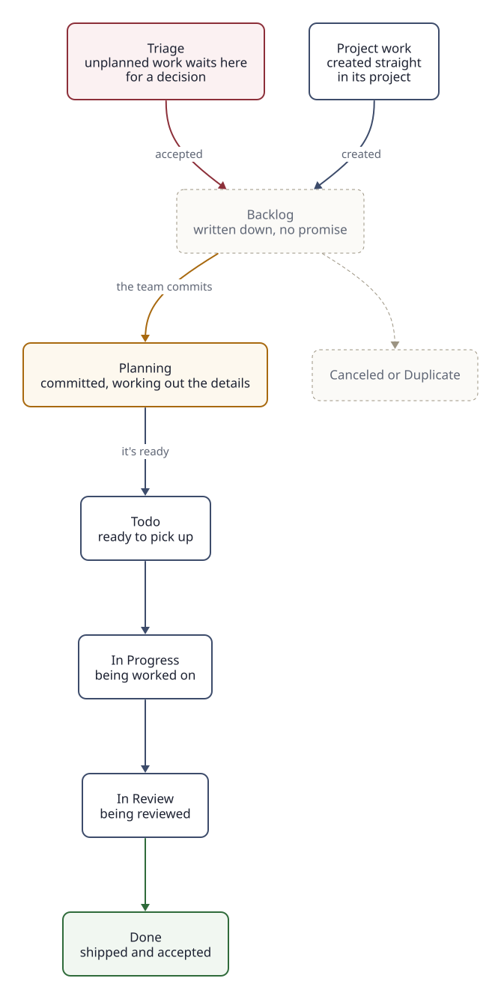

# Issues

For anyone doing the work. An issue is one task: small enough for one person to finish, and
clear enough that everyone agrees when it's done.

[See every issue in Linear.](https://linear.app/happydevs/team/GRI/all) Issues live in the same
tool as the strategy above them, so the reason behind a task is never far away.

!!! abstract "In short"
    - Every issue is one of two kinds: [project work](project-work.md) or
      [inbound work](triage.md) that arrived through Triage.
    - Write the description so that someone could start without asking you anything.
    - Put the assignee, priority, status and labels in Linear's fields. Keep them out of the
      description.
    - Nothing starts until it reaches `Todo`.

---

## :material-directions-fork: Two kinds of issue

Each issue is either in a project or carries one `flow/*` label ([rule 3](../hard-rules.md)).
Which one it is tells you which page to read.

-   :material-clipboard-check-outline: **[Project work](project-work.md)**

    ---

    Planned work inside a project, moving its Key Result. It
    gets a `type/*` label and a template to match.

    For delivery teams. [:octicons-arrow-right-24: Project work](project-work.md)

-   :material-bell-ring-outline: **[Triage work](triage.md)**

    ---

    Inbound work that arrived: an incident, a request, a
    reported fault. It gets one `flow/*` label and no project.

    For the triage rota. [:octicons-arrow-right-24: Triage work](triage.md)

An issue that is neither is unclassified, and nobody can tell where it belongs.

---

## :material-timer-sand: The states an issue moves through

Both kinds of issue use the same states.

| State | Means |
|---|---|
| Triage | In Linear's Triage inbox, waiting for someone to decide where it goes ([Triage work](triage.md)) |
| Backlog | Written down, with no promise to work on it yet |
| Planning | The team has committed to it and is working out the details |
| Todo | Understood and ready to pick up |
| In Progress | Being worked on |
| In Review | Finished and being reviewed |
| Done | Shipped and accepted |
| Canceled | Won't be done, with the reason recorded |
| Duplicate | Covered by another issue |

### Backlog, Planning and Todo { #backlog-planning-todo-commitment-then-readiness }

These three are easy to blur together, so here is what separates them.

- **Backlog** is a parking place. Nobody has promised anything, so an item can sit here for as
  long as it likes and no one is counting.
- **Planning** means the team has said yes. This is where you sharpen the problem, gather
  requirements, agree what done means, size it and clear blockers. We do measure time here,
  because a Planning column that keeps growing shows that refinement can't keep up
  ([Flow](../flow.md)).
- **Todo** means it's ready. Someone can pick it up and start without coming back to ask what it
  means.

Nothing starts from Backlog or Planning. That's why everything `In Progress` was understood
before anyone began.

---

## :material-robot-outline: Write the description as a brief { #the-body-is-the-prompt }

Write an issue's description for whoever picks it up, whether that's a colleague or an AI agent.
It gets written in two stages.

1. When you create the issue, say what the problem is and what done looks like, clearly enough
   that the reader needs nothing else to start. That's all you do at this point.
2. When someone picks it up, they work out how to do it and write that into the issue's
   `## Plan` section, which was left empty until now. The approach can then be reviewed before
   any code is, and the issue stays the one record of the task.

So creating an issue is about getting the task written down. Planning how to do it waits until
someone starts.

---

## :material-table: Use Linear's fields { #native-fields-not-prose }

If Linear has a field for something, use the field and keep it out of the description. Fields
are what let Linear filter, sort and report, and text in a description does none of that.

| Field | Set it to |
|---|---|
| Assignee | The one person doing it |
| Priority | Urgent to Low |
| Status | One of the states above |
| Project or `flow/*` label | Whichever kind of issue it is. Never both |
| Links | Documents, designs, logs and related issues, attached as links |

That leaves the description with the problem, the reason, what done looks like, any context
and, later, the plan. The [`linear-issue`](../skills/index.md) skill fills it in from a template.

---

## Related

- [The hard rules](../hard-rules.md): rule 3 covers issues
- [Flow](../flow.md): spotting where issues get stuck
- [Start here](../index.md): the overview
