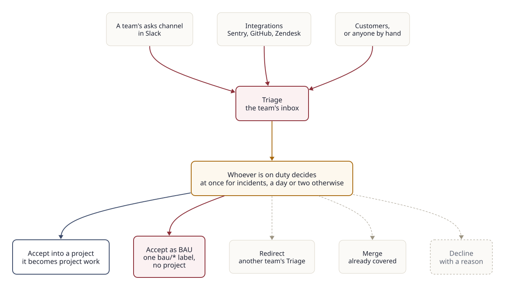

# Triage work

For whoever is on triage duty. Inbound work is the kind nobody planned: an incident, a
request, a reported fault, a quick data question. It arrives in Triage, and your job is to
decide where it goes. Everything on the [Issues](index.md) page applies here too.

!!! abstract "In short"
    - Everything inbound arrives in Linear's Triage inbox.
    - One named person is on duty. They decide, and they don't have to do the work.
    - Every item gets one of five outcomes. Leaving it there isn't one of them.
    - Work that stays inbound gets exactly one `flow/*` label and no project.
    - Decide quickly: at once for incidents, within a day or two for everything else.

---

## :material-door-open: What Triage is

Triage is a feature built into Linear: an inbox for each team, separate from the backlog. New
issues from integrations, Slack, customers and the API arrive there first, so a person decides
where each one goes before it joins the team's work.

Turn it on under **Team settings → Triage**. Work reaches it in a few ways:

- Integrations such as Sentry, GitHub, Zendesk and Intercom create issues straight into it.
- Linear Asks sends requests raised in Slack.
- Customer requests, forms and the API arrive there too.
- Anyone can move a stray issue into Triage by hand when it needs a decision.

Linear's Triage Intelligence can suggest a label, spot likely duplicates and propose a team or
assignee. Treat that as a first guess. The decision is still yours.

---

## :material-account-clock-outline: Who decides

One named person owns the inbox at a time. Use Linear's **Triage responsibility** setting to
assign them and rotate the duty on a schedule, so the queue always has an owner.

The duty is to decide. Doing the work is a separate question, and it often belongs to someone
else.

When you're on duty, the [`linear-triage`](../skills/index.md) skill goes through the inbox with
you and applies each decision.

---

## :material-source-branch: The five outcomes

| Outcome | What it means | In Linear |
|---|---|---|
| Accept into a project | It becomes [project work](project-work.md) | **Accept**, then add it to the project and give it a `type/*` label |
| Accept as flow | It stays inbound | **Accept**, and keep the one `flow/*` label with no project |
| Redirect | It belongs to another team | **Move to team**, and it joins that team's Triage |
| Merge | It's already covered | **Merge** or **Mark duplicate** |
| Decline | We won't do it | **Decline**, with a reason |

!!! tip "Into a project, or stay as flow?"
    Ask whether an open project already owns the thing this touches. A bug in something a
    project is building, or a request the project will deliver anyway, goes into that project.
    Work that stands alone, such as an incident, a one-off question or some upkeep, stays as
    flow.

Work accepted as flow joins the team's normal states, from `Backlog` to `Done`, alongside
everything else. It isn't a lesser queue. You find it again with `flow/*` filters and
dashboards.

If the same kind of flow work keeps coming back, such as the same support theme every cycle,
propose a [project](../projects.md) for it in the usual way. There's no shortcut that turns
recurring flow work into a project.

---

## :material-tag-outline: The `flow/*` labels

Inbound work gets exactly one of these, and no `type/*` label.

| `flow/*` | Use it for |
|---|---|
| `incident` | Something is down or degraded and needs a response now |
| `vulnerability` | A security weakness to fix. Its severity sets the deadline |
| `defect` | A fault reported from outside any project |
| `query` | A one-off data question or report |
| `compliance` | A regulatory or policy obligation |
| `support` | A user or customer request |
| `toil` | Recurring manual work worth recording |

A `product/*` label is optional here. Add one only if the work clearly serves a product.

??? note "Why `defect` and `query`, when project work has `bug` and `analysis`?"
    Linear label names have to be unique across the whole workspace, even between groups. The
    `type/*` group already uses `bug` and `analysis`, so their inbound equivalents needed
    different names.

---

## :material-timer-outline: How fast { #two-clocks }

There are two clocks. The first is how quickly you decide where an item goes.

| Kind of work | Decide within |
|---|---|
| `flow/incident` | Immediately |
| `flow/vulnerability`, `flow/support` | 1 working day |
| `flow/compliance`, `flow/defect`, `flow/toil`, `flow/query` | 2 working days |

The second applies only to vulnerabilities, and it's how quickly they get fixed.

| Severity | Fix within |
|---|---|
| Critical | 7 days |
| High | 30 days |
| Medium | 90 days |

Set a priority while you're deciding. Linear can require one before an issue leaves Triage, and
the priority can drive the deadline.

??? note "Setting the clocks up in Linear"
    Linear's SLA rules measure time to completion. That suits the fix deadline, but Linear has
    no rule for "decide within a day", so the two clocks are set up differently.

    **The decision clock** relies on the rota and on being able to see the queue. Assign Triage
    responsibility (it can link to PagerDuty, Opsgenie and Incident.io), and show time in status
    on the Triage state so an item that's been waiting stands out.

    **The fix deadline** is a Linear SLA rule, available on the Business and Enterprise plans.
    Under *Settings → Issues → SLAs*, add a rule filtered to the `flow/vulnerability` label,
    with severity taken from priority and durations in business days: Critical 7, High 30,
    Medium 90. A few things to know:

    - Rules apply when an issue is created or updated, and never to older issues.
    - The first matching rule wins, so put the most urgent first.
    - An issue can have an SLA or a due date, but not both.
    - Triage Rules can add the label automatically on arrival, which starts the SLA.

    On other plans, or if you'd rather not depend on rules, the
    [`linear-triage`](../skills/index.md) skill sets the issue's `slaBreachesAt` date directly.
    Either way the issue ends up with Linear's SLA fields filled in, and the dashboards and
    [`linear-doctor`](../skills/index.md) watch those.

---

## :material-plus-circle-outline: Create one

Most inbound work arrives without your help. When you need to write one up yourself:

1. The quick way is the [`linear-issue`](../skills/index.md) skill. It sets the single `flow/*`
   label with no project, writes the description and sets the fields.
2. To do it by hand, create the issue in the
   [team's Linear view](https://linear.app/happydevs/team/GRI/all), set one `flow/*` label and
   no project, then paste in a template from the
   [`linear-issue` skill folder](https://github.com/hungovercoders/linear-work-management/tree/main/skills/linear-issue).
   Use `template-bug` for a `defect`, `template-analysis` for a `query`, and `template-action`
   for anything else.

As with every issue, the assignee, priority and status go in [Linear's fields](index.md#fields).

---

## Related

- [Issues](index.md): what every issue has in common
- [Project work](project-work.md): the other kind of issue
- [Start here](../index.md): the overview
