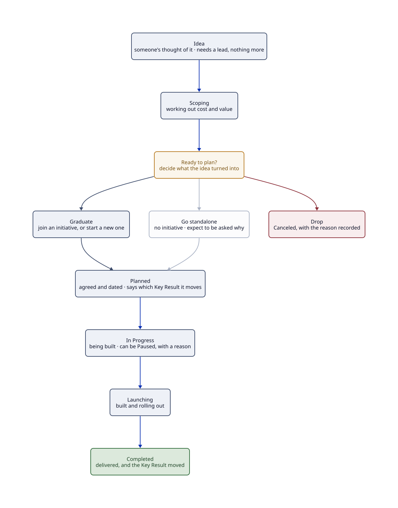

# Projects

For delivery leads

A project is a piece of work with a start, an end and one person leading it. Its job is to move
a Key Result on an [initiative](initiatives.md).

[Open the projects list in Linear](https://linear.app/happydevs/projects/all){ .md-button }

## From idea to done

A project starts as an idea. If the idea holds up, it becomes committed work.

<ol class="lwm-flow">
  <li class="is-quiet"><b>Idea</b>Someone's thought of it</li>
  <li class="is-quiet"><b>Scoping</b>Working out cost and value</li>
  <li class="is-gate"><b>Planned</b>Agreed and dated</li>
  <li><b>In Progress</b>Being built</li>
  <li><b>Launching</b>Rolling out</li>
  <li class="is-done"><b>Completed</b>Delivered, and the Key Result moved</li>
</ol>

A project can also be `Paused` (with a reason and a review date) or `Canceled`.

## Starting out: just an idea { #discovery-phase-is-there-something-here-idea-scoping }

Anyone can start a project in `Idea`. It's the easiest way to begin any piece of work.

- One named lead
- A line on what you're exploring

That's all. No Key Result, no dates, no initiative.

## Becoming planned

This is where an idea turns into a commitment. First decide what it turned into:

Graduate
:   It joins an initiative, either an existing one or a new one its findings justify. This is
    the usual route.

Go standalone
:   It goes ahead with no initiative. Allowed, but expect to be asked why.

Drop
:   Cancel it and record the reason. For an idea, that's a fine result.

A planned project then needs:

- The Key Result it moves, and by how much ("activation, 22% → 30%")
- A start date and a target end date
- A priority, Urgent to Low
- A `spend/*` label (`capex` or `opex`) and a `product/*` label
- Any [dependencies](#dependencies-native-never-prose) on other projects

Put all of these in Linear's own fields. The description is for what you're doing and how, the
Key Result, and what's out of scope.

## Every week while it's being built { #keep-everyone-posted }

The lead posts an update to `#project-updates`: what changed, whether it's on track, and any
risks. Write it on the project in Linear, or let the
[`linear-project-update`](skills/index.md) skill draft it.

"On track" is a claim you should be able to back up. If plenty shipped but the number hasn't
moved, say that.

## Create one

=== "With the skill"

    Ask Claude to "start a project". The [`linear-project`](skills/index.md) skill asks whether
    it's a new idea, an idea ready to be planned, or work that's already agreed, and then asks
    only for what that stage needs.

=== "By hand"

    1. Create a project in [Linear](https://linear.app/happydevs/projects/all).
    2. Set the lead and status, plus everything in the list above if it's planned.
    3. Paste [`template.md`](https://github.com/hungovercoders/linear-work-management/blob/main/skills/linear-project/template.md)
       into the description and fill it in.
    4. Connect the `#project-updates` Slack channel.

## Dependencies { #dependencies-native-never-prose }

If your project can't start until another finishes, record it with Linear's **Blocked by** and
**Blocking** relations. Don't write it in the description, where it goes stale the moment a date
moves.

On the project, press `⌘K` and choose *Dependencies*. Or on the
[timeline](https://linear.app/happydevs/projects/all), drag from the end of one project's bar to
another. The line between them is blue while the dates work and red when they don't. Red means
the two leads need to talk.

??? note "The full picture"
    

    A project whose outcome is already agreed can skip `Idea` and be created straight into
    `Planned`. A project that serves several initiatives names a Key Result for each.
