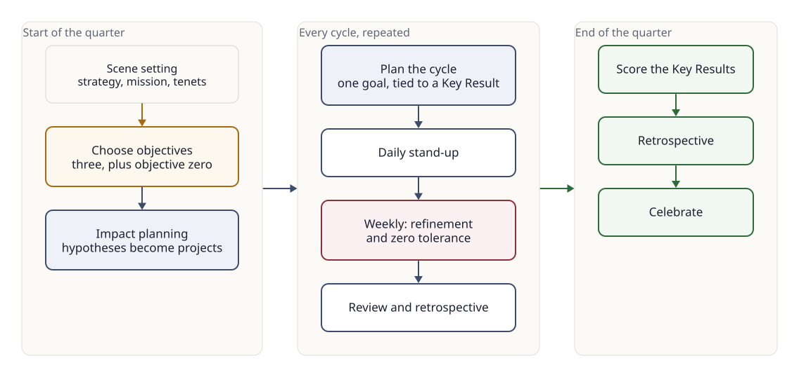

# Recommended team setup

For team owners

This is a starting point for setting a team up in Linear and running it quarter by quarter.
Treat it as a first draft: run a retrospective on it like anything else, and change what
doesn't work.

??? abstract "See it as a diagram"
    

## What every team should have

- A mission that rarely changes, and a few tenets for how the team works
- Three objectives a quarter, each with three Key Results
- An SLA and an issue template in Linear for each kind of BAU it handles
- [Triage](issues/triage.md) switched on, one person on duty, and an asks channel in Slack
- [Cycles](https://linear.app/docs/use-cycles) at a steady length
- Its objectives somewhere every member sees them daily

## Set it up in Linear

1. Create the team with a named owner. Give each person one home team.
2. Keep the [shared issue states](teams.md#issue-states). Add your own only if you need them.
3. Turn Triage on, set Triage responsibility, and
   [connect the team's asks channel](integrations.md#linear-asks).
4. Add an [SLA rule](#service-levels) and an issue template for each kind of BAU the team
   handles.
5. Turn cycles on. Start weekly, or fortnightly if a week is too short to finish anything.
6. Create one [initiative](initiatives.md) for each objective, with your team as its lead team.
7. Add the team's initiatives and current cycle to everyone's sidebar favourites, and keep the
   cycle views open to other teams.

Three [skills](skills/index.md) help with this page. `linear-team-setup` checks a team against
these steps, `linear-objectives` helps choose the quarter's objectives, and
`linear-service-level-check` runs the weekly check.

## Objectives, one quarter at a time

An objective is an initiative, and its Key Results measure it. A project is a hypothesis about
how to move a Key Result, and its issues are the work that tests it.

Pick three objectives. With more than three, none gets enough attention.

Give each one three Key Results with numbers, so partial success still counts. Getting to 70%
of a stretching target usually beats hitting an easy one. Aim for targets the team is 70 to 80%
likely to reach, and say which ones are must-haves. In this guide a must-have is a
[committed](initiatives.md#writing-key-results) Key Result and a stretch is a measured one.

Then use the objectives for every decision about priority. A request that serves none of them is a
fair "no", and because other teams can see your objectives, they can see why.

## BAU, measured with Linear's SLAs { #service-levels }

Objectives change every quarter, but service levels stay. Every team has a few promises it keeps
for as long as it exists, and BAU is the work of keeping them.

Linear has [SLAs](https://linear.app/docs/sla) built in, so use them. An SLA rule puts a
deadline on every issue that matches it, and you can match on team, label and priority. Give
each kind of BAU the team handles its own rule:

| Rule, in this order | Matches | SLA |
|---|---|---|
| Incident | `bau/incident` | Your promise for restoring service |
| Critical vulnerability | `bau/vulnerability`, Urgent | 7 days |
| High vulnerability | `bau/vulnerability`, High | 30 days |
| Medium vulnerability | `bau/vulnerability`, Medium | 90 days |
| Support | `bau/support` | Your promise to the customer |

Only the first rule that matches an issue applies, so put the most urgent at the top. Add a
rule for any other kind where you've made a promise.

An SLA only starts if the issue has the right label and priority, and people forget labels.
So make an [issue template](https://linear.app/docs/issue-templates) for each kind of BAU. The
template sets the `bau/*` label and a default priority, and gives the description its
headings. Offer the same templates in the team's asks channel, and a request raised from Slack
arrives already labelled, with its SLA running.

| Template | Sets | Description from |
|---|---|---|
| Incident | `bau/incident`, Urgent | `template-action` |
| Vulnerability | `bau/vulnerability`, priority by severity | `template-action` |
| Defect | `bau/defect` | `template-bug` |
| Query | `bau/query` | `template-analysis` |
| Support | `bau/support` | `template-action` |

The description templates are in the
[`linear-issue` folder](https://github.com/hungovercoders/linear-work-management/tree/main/skills/linear-issue).

From then on Linear does the measuring:

- Each issue shows its SLA and how close it is: low, medium or high risk, then breached.
- Linear warns subscribers and the team's Slack channel a day before a breach.
- When the issue closes, Linear records the SLA as achieved or failed.
- The [SLA health view](dashboards.md) lists what's open. [Insights](https://linear.app/docs/insights)
  shows the share achieved for each kind of BAU.

That share is how you measure BAU. "We achieved 96% of our vulnerability SLAs this quarter" is
a number a team can report and improve every quarter.

It's also how you size the work. An item in Triage matters because an SLA applies to it. One
that no SLA covers can wait, or be declined.

Some service levels sit outside Linear, such as 99.95% uptime, or nothing running within three
months of its end of life. Measure those in your monitoring tools, check them weekly, and raise
a BAU issue whenever one slips. The SLA then applies to that issue.

BAU comes before the objectives, and it should be the smaller share of the team's time. If the
share of SLAs achieved keeps falling, or BAU starts taking most of the week, don't absorb that
quietly. Use it as evidence, and make fixing the cause one of next quarter's objectives, with a
project to do it.

## The rhythm

| When | What | For how long |
|---|---|---|
| Start of the quarter | Scene setting: the company's strategy, the team's mission and tenets | Up to a day |
| | Choose objectives and Key Results. Sleep on them before confirming | Up to two days |
| | Impact planning: turn the best hypotheses into projects and first issues | Up to two days |
| Every cycle | Plan it around one goal that names the Key Result it serves | Up to 90 minutes |
| | Review what moved, then a retrospective | Up to an hour, then up to 90 minutes |
| Every week | Refinement: move issues through [Backlog, Planning and Todo](issues/index.md#backlog-planning-todo-commitment-then-readiness) | Up to two hours |
| | Service level check: SLAs at risk or breached, plus errors, vulnerabilities and ageing software | Up to an hour |
| Every day | Stand-up. Walk the board from right to left, so the talk is about finishing work | 15 minutes |
| End of the quarter | Score the Key Results, hold a retrospective, and celebrate | Up to four hours |

Linear supports each of these. The cycle review feeds the weekly
[project update](communications.md). The service level check uses the
[SLA health and drift views](dashboards.md). Refinement uses the [Flow](flow.md) views.

## What to avoid

A second way of prioritising
:   If objectives decide some things and a separate list decides others, the team is back to
    arguing in every planning session.

Key Results tied to anyone's pay
:   People start gaming the number and lose sight of the shared goal. Reward what someone did for
    their own skills, their team and other teams.

Objectives nobody sees
:   If they only appear at the quarterly review, they won't steer the daily work.

Refining requests that serve no objective
:   Look at every unplanned request in refinement. If it serves no objective, decline it.

??? note "If this is new to the team"
    Start with monthly objectives. You'll find out sooner whether they're working, and you can
    change course before committing to a full quarter.

??? note "Choosing objectives: eight things to look at"
    Go through these with real numbers in front of you. If you find you're guessing, make
    getting the numbers your first objective.

    Precision
    :   Can we tell which of the others needs attention? Do we have the data?

    Performance
    :   How well are our products doing? Conversion, satisfaction, coverage.

    Deliverability
    :   How fast can we ship a change? Lead time, deploys a day, rollbacks.

    Cost
    :   What are we spending on cloud and contracts?

    Reliability
    :   Uptime, and how many alerts we get.

    Risk
    :   Critical vulnerabilities and compliance events.

    Developer experience
    :   Is the team happy building here? Complexity, skills coverage.

    Integration
    :   How easily can other teams use what we produce?

??? note "Where this comes from"
    The cadence, the weekly service level check and the eight things to look at come from
    [Integrating OKR Cycles into the Agile Framework](https://hungovercoders.com/blog/2024-02-24-okr-agile-cycles/),
    adapted to how this guide uses Linear. The post calls BAU "objective zero" and the weekly check
    "zero tolerance". Here BAU stays outside the objectives, because its service levels never
    expire. A team leading an initiative needs Linear's Business
    or Enterprise plan. On other plans, name the team in the initiative's description.
